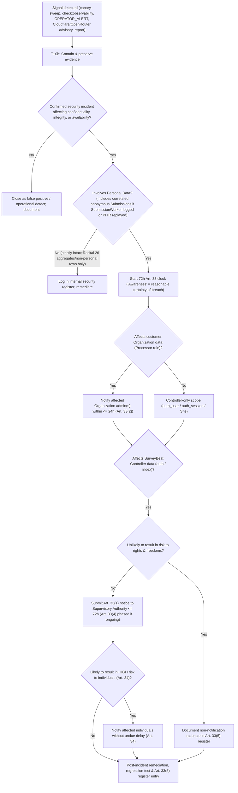

# Personal Data Breach Detection & Notification Runbook — GDPR Articles 33–34

**Scope:** All production and non-production Cloudflare stages (`MainWorker`, `SubmissionWorker`, `SiteWorker`, `Organization` Durable Objects, `Database` D1, Queues, Cloudflare Email Sending) and external sub-processors (`OpenRouter`, `Google Cloud Vertex EU`, `AWS Bedrock eu-west-1`).  
**Vocabulary:** Domain terms follow [`GLOSSARY.md`](../../GLOSSARY.md).  
**Related Docs:** [`ropa.md`](./ropa.md), [`dpia.md`](./dpia.md), [`vendor-dpa-register.md`](./vendor-dpa-register.md), [`docs/infra.md`](../infra.md).

---

## 1. Roles, Legal Clocks & Notification Thresholds

| SurveyBeat GDPR Role | Trigger & Scope | Statutory Deadline | Recipient |
| --- | --- | --- | --- |
| **Data Processor** (Art. 33(2)) | Any Personal Data Breach affecting customer `Organization` data (`person`, `membership`, `email_send`, `round_member`, `invitation`, `participation`, `action`, `round_note`, `person_index`, `invitation_index`, or compromised `SubmissionWorker` logs). | **Without undue delay** — **Internal SLA: <= 24 hours** from awareness (gives customer Controllers time to meet their 72-hour Art. 33(1) clock). | Affected `Organization admin`(s) / designated customer security & privacy contacts. |
| **Data Controller** (Art. 33(1)) | Personal Data Breach affecting SurveyBeat-controlled data (`auth_user`, `auth_session`, `auth_account`, `auth_verification`, `auth_passkey`, `organization_claim`, `ORG_CREATION_ALLOWLIST`), **unless** unlikely to result in a risk to rights and freedoms. | **Without undue delay and <= 72 hours** after becoming aware (phased info permitted under Art. 33(4) if full forensics take longer). | Competent EU/EEA Supervisory Authority (and UK ICO / Swiss FDPIC where applicable). |
| **Data Controller** (Art. 34) | Controller-scope breach **likely to result in a high risk** to the rights and freedoms of natural persons (unless Art. 34(3) exemptions apply, e.g., strong encryption with uncompromised keys). | **Without undue delay** after triage confirms high risk. | Affected individuals (`Person`s / sign-in account holders), in clear and plain language. |
| **Internal Register** (Art. 33(5)) | **Every** confirmed Personal Data Breach or near-miss security incident, regardless of whether notification is required. | Logged immediately upon closure (preserved for audit). | Internal Breach Register (§7.4). |

> **Note on Recital 26 Anonymous Data:** Intact `submission` and `answer` rows without correlation paths are non-personal data (`ropa.md` §3). However, **if a breach exposes correlation metadata** (e.g., `SubmissionWorker` logging was accidentally turned on, or a PITR WAL replay occurred without authorization alongside `participation`), treat the affected `Round`s as **personal data** for breach classification and notification purposes.

---

## 2. Detection Channels in This Repository

Incident detection relies on the following concrete mechanisms built into SurveyBeat and its Cloudflare/sub-processor stack:

1. **Observability & Canary Privacy Gates (`SubmissionWorker`):**
   - `pnpm check:observability --stage <stage>` ([`infra/scripts/check-observability.ts`](../../infra/scripts/check-observability.ts)): Queries Cloudflare Workers settings API (`GET /accounts/{id}/workers/workers`) and fails if `observability.enabled`, `logs.enabled`, `traces.enabled`, `logpush`, or `tail_consumers` is enabled on `SubmissionWorker`.
   - `pnpm test:preview-privacy` ([`infra/tests/privacy/canary-sweep.ts`](../../infra/tests/privacy/canary-sweep.ts)): Sends 1,000 canary requests to `MainWorker` (positive control) and `SubmissionWorker` and fails if any `SubmissionWorker` event or canary string appears in Workers Logs.
   - Executed automatically in `.github/workflows/preview.yml` (`preview-privacy`) and `.github/workflows/deploy.yml` (`staging-privacy` blocking `production` deploy).
2. **Worker & Durable Object Operator Alerts (`[OPERATOR_ALERT]`):**
   - `Organization.ts` (`ALARM_FAILED`) and `organization/RoundJobs.ts` (`ROUND_JOB_FAILED`, results computation failures) emit `[OPERATOR_ALERT]` structured `Effect.logError` events to Cloudflare Workers Logs (`MainWorker`).
   - Dead-letter queue consumers (`JobsDlq`, `EmailDlq` in `MainWorker.ts`) emit `JOB_DEAD_LETTERED` and `EMAIL_DEAD_LETTERED` error logs (error codes / `sendId` only, never message bodies).
3. **Cloudflare Platform & Audit Monitoring:**
   - Cloudflare Account Audit Logs (API token usage, `alchemy deploy` changes, D1/DO/R2 access, manual PITR restore triggers—restricted to named operators per ADR 0005).
   - Cloudflare Workers/D1/DO error-rate alerts and Email Sending bounce/complaint spikes (`EmailEvents` queue).
4. **Authentication & Access Anomaly Signals:**
   - `ORG_CREATION_ALLOWLIST` diffs (`infra/org-creation-allowlist.yaml`).
   - D1 `auth_session`, `auth_verification`, and `auth_passkey` anomalies (e.g., unusual session creation, failed OTP spikes beyond `Policy.signIn.codeAttempts = 5`, or unexpected `MainWorker` 401/403/500 spikes).
5. **Sub-processor Security Advisories & Upstream Failures:**
   - Security notifications from **Cloudflare**, **OpenRouter** (DPA commits to 72-hour breach notice), **Google Cloud (Vertex EU)**, or **AWS (`eu-west-1`)**.
   - Unexpected `AiRejected` / `AiUnavailable` bursts in `OpenRouterAiClient.ts` (which fails closed if EU ZDR endpoints drop or reject requests).
6. **Human / Customer / CI Reports:**
   - Security disclosures, customer reports of misdirected emails or self-identifying comments, or accidental real data in non-production `captured_email`.

---

## 3. Severity Classification Matrix

| Severity | Criteria & SurveyBeat Examples | Default Notification Path |
| --- | --- | --- |
| **Critical (P1)** | Confirmed unauthorized access or exfiltration enabling **re-identification of anonymous `Submission`s** (e.g., `SubmissionWorker` logs enabled in `production` + captured traffic, unauthorized DO PITR restore + correlation, cross-`Organization` DO access); or mass exfiltration of D1 `auth_user`/`person_index` + active `auth_session` tokens. | Processor notice to affected `Organization`s **<= 24h**; Controller Art. 33(1) filing **<= 72h**; Art. 34 individual notice assessment immediately. |
| **High (P2)** | Unauthorized read/exposure of identifiable `Organization` or auth data without breaking `Submission` anonymity (e.g., `person`, `email_send`, `round_member`, `invitation`, `captured_email`, `auth_user` emails, or unredacted comment leaked via `MainWorker` before redaction/in error path); or confirmed sub-processor ZDR failure retaining `RedactedText` comments outside EU. | Processor notice **<= 24h**; Controller Art. 33(1) filing **<= 72h** if Controller data affected; Art. 34 risk evaluation. |
| **Medium (P3)** | Limited exposure of low-sensitivity metadata or single-account compromise (e.g., single `auth_session` token leaked and promptly revoked, single `Invitation` email misdirected before answering without exposing `Submission`, non-prod `captured_email` containing synthetic/staging emails exposed briefly). | Assess risk to rights & freedoms; notify affected `Organization` (`<= 24h` if customer data involved); log in Art. 33(5) register; file Art. 33(1) only if risk > unlikely. |
| **Low (P4)** | Security event contained before personal data exposure (e.g., `staging-privacy` catches observability misconfiguration prior to `production` deploy; blocked OTP brute-force at 5 attempts; `OpenRouterAiClient` fails closed when EU ZDR is unavailable). | No external breach notification required; document in Art. 33(5) incident log & remediate root cause. |

---

## 4. 72-Hour Response Timeline & Decision Tree

### 4.1 Decision Tree



### 4.2 Time-Boxed Action Checklist

| Window | Owner | Required Actions |
| --- | --- | --- |
| **T+0h – T+2h** | On-call Operator | **Contain immediately:** preserve logs/evidence first, then isolate the vector (see §5 Containment Playbook). Open incident channel and assign Incident Commander (IC). |
| **T+2h – T+6h** | IC & Engineering | **Triage & Scope:** determine exact tables/DOs/stages affected, count affected `Organization`s and `Person`s, check whether `SubmissionWorker` observability or AI endpoints were affected, assign Severity (`P1–P4`). |
| **T+6h – T+24h** | IC & Privacy/Legal | **Processor Notification (Art. 33(2)):** send initial written notice to all affected customer `Organization`s (`<= 24h` SLA) using Template §6.1, even if root-cause forensics are still underway. |
| **T+24h – T+48h** | Privacy/Legal & IC | **Authority & Individual Risk Assessment:** if SurveyBeat Controller data is affected (`auth_*`, `person_index`, `organization_claim`), draft Supervisory Authority report (§6.2) and evaluate Art. 34 high-risk threshold. |
| **<= T+72h** | Privacy/Legal | **Supervisory Authority Filing (Art. 33(1)):** file complete report (or initial phased report under Art. 33(4)) with the lead supervisory authority. Issue Art. 34 individual notices (§6.3) without undue delay if high risk applies. |
| **Post-Incident (<= 14d)** | Engineering & Privacy | Add permanent regression test (unit / `*.privacy.test.ts` / CI gate), update `dpia.md` if threat model shifted, and complete Art. 33(5) Breach Register entry (§6.4). |

---

## 5. SurveyBeat-Specific Containment Playbook

Execute only the steps matching the confirmed vector, preserving forensic timestamps before mutating state:

- **`SubmissionWorker` logging/traces enabled:** Immediately redeploy `SubmissionWorker` via `pnpm infra:deploy --stage production` (or patch script settings via Cloudflare API) and verify `pnpm check:observability --stage production` and `pnpm test:preview-privacy` pass; audit Cloudflare Workers Logs retention window for any captured payloads.
- **Session / Auth compromise (`auth_session`, `BETTER_AUTH_SECRET`):** Revoke affected `auth_session` rows in D1 (which cascades `auth_session_organization`), rotate `BETTER_AUTH_SECRET`, and force re-authentication.
- **`Invitation` / `Edit key` secret compromise (`INVITATION_TOKEN_KEY`):** Rotate `INVITATION_TOKEN_KEY` in Alchemy/Cloudflare secrets, revoke unredeemed `invitation`s in affected `Organization` DOs, and purge stale `invitation_index` rows.
- **AI sub-processor incident (`OPENROUTER_API_KEY` / EU ZDR breach):** Revoke/rotate `OPENROUTER_API_KEY` in Cloudflare Worker secrets (which causes `OpenRouterAiClient` to fail closed with `AiNotConfigured` immediately—zero further calls leave the DO), and notify affected `Organization`s with `ai_processing = 1`.
- **Cloudflare account / API token compromise:** Revoke `CLOUDFLARE_API_TOKEN` in Cloudflare dashboard, audit `alchemy-state-store` and Cloudflare Audit Logs for any unauthorized `Organization` DO PITR restores or code deployments.

---

## 6. Notification & Register Templates

### 6.1 Customer Organization Notification Template (GDPR Art. 33(2) — Target <= 24h)

```markdown
Subject: [SECURITY NOTICE] Personal Data Incident Notification — SurveyBeat (Ref: INC-YYYY-NNN)

Dear [Organization Admin / Designated Contact] of [Organization Name],

We are writing to notify you without undue delay pursuant to Article 33(2) of the GDPR and our Data Processing Agreement regarding a security incident involving SurveyBeat that affects (or may affect) your Organization.

1. Summary & Timeline
- Incident ID: INC-YYYY-NNN
- Time detected (UTC): [YYYY-MM-DD HH:MM UTC]
- Time SurveyBeat became aware of personal data impact (UTC): [YYYY-MM-DD HH:MM UTC]
- Current status: [Contained / Under active investigation]

2. Nature of the Incident
[Concise description of what happened, which Worker/store/sub-processor was involved, and whether confidentiality, integrity, or availability was affected.]

3. Categories and Approximate Numbers Affected
- Affected Organization ID: [organization_id]
- Categories of data subjects: [e.g., Team members, Leads, Organization admins]
- Categories of personal data: [e.g., email addresses in person / email_send; note explicitly whether anonymous Submission/Answer data remained unlinkable under Recital 26 or whether correlation risk exists]
- Approximate number of records / individuals affected: [count or range]

4. Likely Consequences
[Assessment of potential impact on affected Persons and whether Submission anonymity was preserved.]

5. Containment & Remediation Measures Taken
- [Action 1 + timestamp]
- [Action 2 + timestamp]

6. Recommended Customer Actions & Contact
- [Any action required from Organization admin, e.g., revoking/re-inviting or notifying internal DPO]
- SurveyBeat Incident Contact / DPO: [name, email, phone]
- Next update scheduled: [YYYY-MM-DD HH:MM UTC]
```

### 6.2 Supervisory Authority Notification Template (GDPR Art. 33(3))

```markdown
SUPERVISORY AUTHORITY PERSONAL DATA BREACH NOTIFICATION (GDPR ART. 33)
Submission Type: [Initial Notification (<= 72h) / Phased Update (Art. 33(4)) / Final Report]
Incident Reference: INC-YYYY-NNN

1. Controller Details (Art. 33(3)(b))
- Legal entity: [SurveyBeat Legal Entity Name, Address]
- Data Protection Officer / Privacy Contact: [Name, Role, Email, Phone]

2. Nature of the Personal Data Breach (Art. 33(3)(a))
- Date & time breach occurred (est.): [YYYY-MM-DD HH:MM UTC]
- Date & time controller became aware: [YYYY-MM-DD HH:MM UTC]
- If > 72h, reasons for delay (Art. 33(1)): [N/A or explanation]
- Cause & type of breach: [Confidentiality / Integrity / Availability; root cause]
- Categories of data subjects affected: [e.g., signed-in account holders]
- Approximate number of data subjects affected: [count]
- Categories of personal data records affected: [e.g., email addresses, session/IP metadata]
- Approximate number of personal data records affected: [count]

3. Likely Consequences of the Breach (Art. 33(3)(c))
- Risk rating: [Low / Medium / High]
- Assessment of potential harm to data subjects: [e.g., phishing risk, unauthorized account access]
- Art. 34 individual notification status: [Required & sent / Not required — rationale]

4. Measures Taken or Proposed (Art. 33(3)(d))
- Containment measures executed: [list]
- Measures to mitigate possible adverse effects on individuals: [list]
- Preventive technical/organizational fixes: [list + PR/test references]

5. Cross-Border / Sub-processor Details (if applicable)
- Affected EEA member states / lead supervisory authority rationale: [...]
- Involved sub-processors notified: [...]
```

### 6.3 Affected Individual Notification Template (GDPR Art. 34)

```markdown
Subject: Important security notice regarding your SurveyBeat account

Hello,

We are contacting you to let you know about a security incident at SurveyBeat that may affect your personal information.

What happened:
[Plain-language explanation of the incident and dates.]

What information was involved:
[Exact list of personal data involved, e.g., your email address or sign-in session details. Explicitly clarify whether anonymous Pulse answers were unaffected.]

What we are doing:
[Plain-language summary of containment, session revocation, key rotation, and preventive fixes.]

What you can do:
[Clear, actionable steps, e.g., ignore suspicious emails, verify passkeys, contact support.]

How to reach us:
If you have questions, please contact our privacy team / Data Protection Officer at [privacy@surveybeat.app / DPO contact].
```

### 6.4 Internal Personal Data Breach Register Template (GDPR Art. 33(5))

Maintain one immutable row per incident in the governance repository / compliance log:

| Incident ID | Date Detected (UTC) | Date Aware (UTC) | Role (Controller / Processor) | Summary & Root Cause | Affected Systems / Tables | Data Subjects & Record Count | Severity | Notified `Organization`s (Art. 33(2) <= 24h)? | Notified Authority (Art. 33(1) <= 72h)? | Notified Individuals (Art. 34)? | Rationale if Not Notified | Corrective Actions & Regression Test Link | Closed Date |
| --- | --- | --- | --- | --- | --- | --- | --- | --- | --- | --- | --- | --- | --- |
| `INC-YYYY-001` | | | | | | | | Yes/No (timestamp) | Yes/No (timestamp) | Yes/No (timestamp) | | | |
